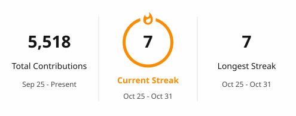

# Wyatt Stanczyk

I build native macOS apps in Swift, command line tools for coding agents, and web apps in TypeScript, and I like working close to the platform: Carbon hotkeys, the App Sandbox, the Keychain, SQLite's C API and raw WebGL2 with hand-written shaders.

[wyattstanczyk.com](https://wyattstanczyk.com) · [Copy 2FA](https://stanczykwyatt.github.io/copy-2fa/) · [Show Desktop](https://stanczykwyatt.github.io/show-desktop/) · [Who Stole My Focus](https://stanczykwyatt.github.io/who-stole-my-focus/) · [mulligan](https://stanczykwyatt.github.io/mulligan/) · [symbolhop](https://stanczykwyatt.github.io/symbolhop/)

## Free Mac utilities

Small, private menu bar apps for macOS. Each one is free and open source, runs in the App Sandbox with no network entitlement, and has zero dependencies. What's coming next is on the [public roadmap](https://github.com/users/stanczykwyatt/projects/1).

### [ Copy 2FA](https://github.com/stanczykwyatt/copy-2fa)

Copies the newest verification code from Mail or Messages, or from a built-in TOTP/HOTP authenticator, with one keyboard shortcut. Swift 6 on macOS 14+, zero dependencies, plus a C#/.NET port for Windows.

<picture>
  <source media="(prefers-color-scheme: dark)" srcset="profile/copy-2fa-picker-dark.png">
  
</picture>

- **No network entitlement.** It runs in the App Sandbox, and CI inspects the built app with `codesign` on every push and fails if a network entitlement ever appears.
- **No Accessibility permission.** The global shortcut uses Carbon's `RegisterEventHotKey`, and Mail is driven over Apple Events after checking consent with `AEDeterminePermissionToAutomateTarget`.
- **Parsers written from scratch:** a `typedstream` decoder for message bodies in `chat.db`, opened read-only through the SQLite C API, and a protobuf wire-format reader for Google Authenticator exports. They live in a pure `Copy2FACore` target that is stress-tested with thousands of damaged inputs.
- **Secrets stay on the Mac.** OTP keys live in a non-synced Keychain item behind Touch ID, codes are computed with CryptoKit HMAC (SHA-1/256/512), and HOTP counters are saved before a code is copied.
- **Clipboard hygiene.** `.currentHostOnly` keeps codes off Universal Clipboard, `ConcealedType` and `TransientType` keep them out of clipboard managers, and `sharingType = .none` hides the notice from screenshots and screen sharing.

### [ Show Desktop](https://github.com/stanczykwyatt/show-desktop)

The Windows+D shortcut for the Mac: one click or ⌃⇧D hides every window, and the next puts back exactly what was open. Swift 6 and AppKit on macOS 14+, zero dependencies.

- **Restores the exact state.** It records which apps were visible and orders them back to front from `CGWindowListCopyWindowInfo`, so the second click unhides only those, leaves apps you'd already hidden alone and puts the app you were using back in front. That logic is a pure `ShowDesktopCore` target with its own tests.
- **Works around macOS's activation rules.** Hiding the frontmost app makes macOS promote the next one, so Finder is activated first and stragglers get a second pass.
- **Least privilege.** App Sandbox with no network or file entitlements, a single Apple Events exception for Finder (window IDs only, never user text, go into the scripts), and a Carbon hot key instead of Accessibility. CI fails the build if a network or file entitlement ever appears.

### [ Who Stole My Focus](https://github.com/stanczykwyatt/who-stole-my-focus)

Names the app that jumps in front of your work, including in the middle of typing, from a menu bar log of every app that comes to the front. Swift 6, AppKit and SwiftUI on macOS 14+, zero dependencies.

<picture>
  <source media="(prefers-color-scheme: dark)" srcset="https://github.com/stanczykwyatt/who-stole-my-focus/raw/main/docs/screenshot-dark.png">
  
</picture>

- **No permissions at all.** Detection uses only `NSWorkspace` activation, launch, hide and Space notifications plus `CGEventSource.secondsSinceLastEventType` idle times, which macOS gives sandboxed apps without Accessibility or Input Monitoring. CI fails the build if any entitlement besides the App Sandbox, or any event tap, AX, screen-capture or networking call, appears.
- **Telling steals from switches.** A pure `FocusCore` target picks the likeliest cause from input timing (a click with no typing since, the instant ⌘ comes up after ⌘Tab, a keypress in a launcher), walks a short history of recent fronts so focus returning after a password prompt or the lock screen isn't blamed, and takes a second look 0.4 s later: did you keep typing, did the Space change, did the last app quit after all.
- **Tested off screen.** 170+ Swift Testing tests, including the system monitor fed a private `NotificationCenter` and the SwiftUI log rendered from windows that are never shown. The README screenshots come from those renders.

## Tools for coding agents

Free, open-source command line tools for Codex, Claude Code, Gemini CLI and other terminal agents. Both make no network calls and have zero dependencies.

### [ mulligan](https://github.com/stanczykwyatt/mulligan)

Undo for coding agents. A snapshot at every prompt and tool call, shell commands included, so you can list, diff and undo back to any point. One Swift binary for macOS and Linux that needs only git.

- **Never touches your repo.** Snapshots go into a separate git repository outside the project, with every inherited `GIT_*` variable, global config and hook shut out.
- **Restore can't lose a file.** It snapshots first, fails closed, and leaves alone anything it couldn't put back: ignored files, big files, nested repos.

### [ symbolhop](https://github.com/stanczykwyatt/symbolhop)

Go-to-definition and find-references for coding agents: an MCP server and CLI that asks your language servers instead of grepping. Node 20+, no dependencies.

- **Its own LSP client.** It picks a server per file (clangd, pyright, gopls, rust-analyzer and more), runs several at once, and takes symbols by name instead of column.
- **Measured, not guessed.** On a made-up C project a function's uses came back as 10 exact lines against 59 to 77 from grep, and CI reruns the measurement.

## Website

### [wyattstanczyk.com](https://wyattstanczyk.com)

My personal site: Next.js 16 and React 19 with no other runtime dependencies, deployed on Vercel.

- **Raw WebGL2, no 3D library.** A ray-marched SDF scene in hand-written GLSL renders into half-float HDR framebuffers, followed by a post pass with bloom, ACES tone mapping and dithering.
- **HDR reflections** from an equirectangular environment map, decoded by a hand-written Radiance `.hdr` (RGBE with run-length encoding) loader and blurred by roughness through its mip chain.
- **Cache Components** (`"use cache"` with `cacheLife("hours")`) for live GitHub data, and a strict Content Security Policy with security headers on every route.
- Respects `prefers-reduced-motion` and caps the device pixel ratio at 2.

## Toolbox

<table>
  <tr><td><b>Languages</b></td><td>Swift · TypeScript · C# · GLSL · SQL · Bash</td></tr>
  <tr><td><b>Apple</b></td><td>SwiftUI · AppKit · Carbon · Security · LocalAuthentication · CryptoKit · App Sandbox · Swift Package Manager</td></tr>
  <tr><td><b>Web</b></td><td>Next.js · React · Tailwind CSS · WebGL2 · Node.js</td></tr>
  <tr><td><b>Agents</b></td><td>MCP · Language Server Protocol · agent hooks</td></tr>
  <tr><td><b>Data and infra</b></td><td>Supabase (Postgres) · SQLite · Vercel · GitHub Actions · GitHub Pages</td></tr>
</table>

## GitHub stats

<picture>
  <source media="(prefers-color-scheme: dark)" srcset="profile/stats-dark.svg">
  
</picture>
<picture>
  <source media="(prefers-color-scheme: dark)" srcset="profile/streak-dark.svg">
  
</picture>

Cards are rendered daily by a <a href="https://github.com/stanczykwyatt/stanczykwyatt/blob/main/.github/workflows/profile-cards.yml">GitHub Actions workflow</a> in this repo rather than a shared public instance.
